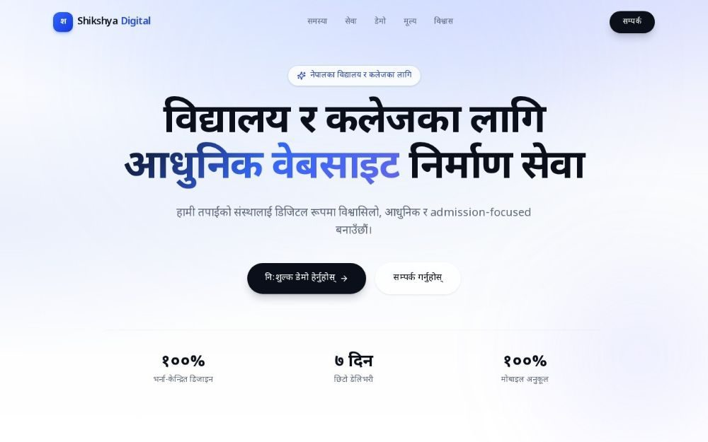

# Shikshya Digital

**Modern websites for schools and colleges in Nepal.** A Nepali-language landing page that sells a website-building service to school and college owners: the problem, the solution, demo projects, pricing and a contact form.

**Live site:** [shikshya-digital.vercel.app](https://shikshya-digital.vercel.app)



## Sections

1. Hero with the core offer and key numbers
2. The problem schools face online
3. The solution and what a school gets
4. Why it matters for admissions
5. Demo projects
6. Trust and proof
7. Pricing
8. Final call to action with a contact form

## Tech stack

- Next.js 16 (App Router), React 19, TypeScript
- Tailwind CSS 4 and Framer Motion animations
- Lucide icons and Nepali web fonts
- Image optimisation scripts for the demo galleries

## Run locally

```bash
npm install
npm run dev        # http://localhost:3000
```

Production build:

```bash
npm run build
npm start
```

## Project structure

```
src/
├── app/            # layout, page, global styles
├── components/
│   ├── layout/     # Header, Footer
│   ├── sections/   # Hero, Problem, Solution, WhyItMatters, DemoProjects, Trust, Pricing, FinalCTA
│   └── ui/         # Button, SectionHeading and other parts
└── lib/            # animation variants, nav links, contact info
```

Contact details live in `src/lib/constants.ts`. The contact form is in `src/components/sections/FinalCTA.tsx`.

---

Built by **Ajit Thapa Magar**, web developer and product manager in Kathmandu. Portfolio: [ajit-portfolio-six.vercel.app](https://ajit-portfolio-six.vercel.app)
